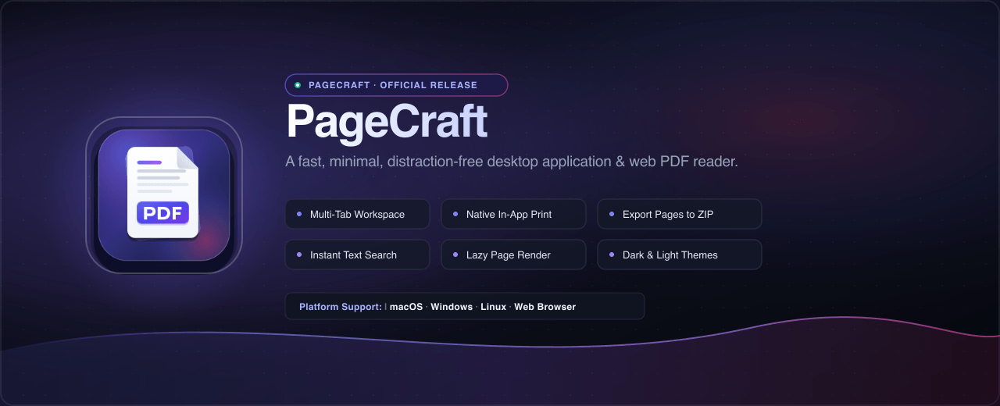

<p align="center">
  
</p>

<p align="center">
  <a href="#-building-for-distribution"></a>
  <a href="https://tauri.app"></a>
  <a href="https://react.dev"></a>
  <a href="https://www.typescriptlang.org"></a>
  <a href="https://vitejs.dev"></a>
  <a href="https://mozilla.github.io/pdf.js"></a>
  <a href="#license"></a>
</p>

<p align="center">
  <strong>PageCraft</strong> is an ultra-fast, minimal, and beautiful document reader built with <strong>Tauri v2</strong>, <strong>React 18</strong>, and <strong>PDF.js</strong>.<br />
  Engineered for distraction-free reading with smooth continuous scrolling, multi-tab workflows, in-app vector printing, and page-to-image extraction.
</p>

<p align="center">
  <a href="#-key-features">Key Features</a> •
  <a href="#-quick-start">Quick Start</a> •
  <a href="#-keyboard-shortcuts">Shortcuts</a> •
  <a href="#-building-for-distribution">Distribution</a> •
  <a href="#-architecture">Architecture</a>
</p>

---

## ✨ Key Features

### 📑 Multi-Tab Workspace
- Open and manage up to **10 PDF documents simultaneously** with an intuitive, native-feeling tab bar.
- Each tab preserves its own independent scroll position, current page, and zoom level.
- Quickly cycle through open documents using `Ctrl / ⌘ + Tab` and `Ctrl / ⌘ + Shift + Tab`.

### 🎨 Aesthetic Aurora & Wave Interface
- Fluid, GPU-accelerated animated SVG waves and ambient aurora mesh glows create a calming home screen.
- Frosted glassmorphism (`backdrop-filter: blur`) cards with anti-aliased border radii.
- Seamless **Dark** and **Light** themes with smooth color transitions and persistent state.

### 🖨️ High-Fidelity In-App Native Print Dialog
- Prints documents with **100% original vector sharpness**, exact typography, and paper geometries.
- **Desktop (macOS)**: Integrates directly with native `PDFKit` and `AppKit` (`NSPrintOperation`), sliding down the native macOS print sheet right inside the window without opening external preview applications.
- **Web**: Uses an isolated, offscreen streaming `<iframe>` print pipeline with automatic memory cleanup.

### 📦 Multi-Format Page Extraction (ZIP Download)
- Extract every page of any PDF into crisp image files:
  - **PNG (`.png`)**: High-resolution lossless extraction at $2.0\times$ scale (ideal for diagrams and fine text).
  - **JPG (`.jpg`)**: High-efficiency photographic compression.
  - **WebP (`.webp`)**: Modern, compact web image format.
- **Zero-Dependency High-Speed ZIP Generator**: Built-in in-memory PKZip 2.0 containerizer with 32-bit CRC validation.
- **Human-Readable File Naming**: Structured naming with zero-padding (e.g., `Document - Page 01.png`, `Document - Extracted Pages (PNG).zip`).
- **Interactive Progress Modal**: Live progress bar, stage indicator, and cancellation support (`Escape` or Cancel button). Saves via native OS dialog in desktop mode.

### 🔍 Instant Full-Text Document Search
- Real-time full-document keyword matching with match counter indicator (`X / Y`).
- Jump forward (`Enter`) and backward (`Shift + Enter`) through matches across all pages.
- Highlighted text occurrences rendered directly within the selectable text layer.

### ⚡ Continuous Scroll & Lazy Rendering
- Vertical continuous document flow with lazy page virtualization powered by `IntersectionObserver`.
- Automatic viewport page tracking synchronized with the toolbar indicator and thumbnail navigation.
- Low-memory footprint: pages outside the preload threshold are cleanly de-allocated.

### 🕒 Persistent Recent Documents
- Card-based home screen grid displaying previously opened files with last-read page badges (`Page X of Y`).
- Backed by **IndexedDB** binary buffer storage for instant re-opening even in browser mode.
- Clear individual files or wipe all document history and cache in one click.

---

## ⌨️ Keyboard Shortcuts

| Shortcut | Action | Description |
| :--- | :--- | :--- |
| `Ctrl / ⌘ + O` | **Open File** | Open native OS file picker (supports multi-selection) |
| `Ctrl / ⌘ + P` | **Print** | Trigger native in-app print dialog sheet |
| `Ctrl / ⌘ + F` | **Search** | Open full-text document search bar |
| `Ctrl / ⌘ + W` | **Close Tab** | Close active tab (returns to home screen when last tab closes) |
| `W` *(without Ctrl)* | **Fit to Width** | Instantly fit active page to viewer container width |
| `Ctrl / ⌘ + Tab` | **Next Tab** | Switch to the next open document |
| `Ctrl / ⌘ + Shift + Tab` | **Previous Tab** | Switch to the previous open document |
| `→` / `↓` / `Space` | **Next Page** | Navigate to the subsequent document page |
| `←` / `↑` | **Previous Page** | Navigate to the preceding document page |
| `Ctrl / ⌘ + =` | **Zoom In** | Increase document zoom level |
| `Ctrl / ⌘ + -` | **Zoom Out** | Decrease document zoom level |
| `Ctrl / ⌘ + 0` | **Reset Zoom** | Reset zoom level to 100% |
| `Ctrl + Scroll` | **Pinch Zoom** | Smooth mouse wheel zoom adjustment |
| `Click + Drag` | **Pan Document** | Pan around the canvas when zoomed in |
| `Escape` | **Close / Cancel** | Close search bar or abort ongoing extraction |

---

## 🚀 Quick Start

### Prerequisites

| Tool | Recommended Version | Download |
| :--- | :--- | :--- |
| **Node.js** | `>= 18.x` | [nodejs.org](https://nodejs.org) |
| **Rust & Cargo** *(for desktop)* | `stable` | [rustup.rs](https://rustup.rs) |

---

### Installation

```bash
# 1. Clone the repository
git clone https://github.com/your-username/pagecraft.git
cd pagecraft

# 2. Install dependencies
yarn install
```

---

### Running in Development

#### 🖥️ Desktop Application (Tauri Live Reload)
```bash
yarn dev:desktop
```

#### 🌐 Web Application (Browser Mode)
```bash
yarn dev
```
Open [http://localhost:1420](http://localhost:1420) in your browser. All viewer features, search, tab management, and extraction work identically in web mode.

---

## 📦 Building for Distribution

### Unified Desktop Build Script
Run the automated desktop builder script:
```bash
yarn build:all
```

### Platform-Specific Commands

```bash
# macOS (.app & .dmg)
yarn build:mac

# macOS Universal Binary (Apple Silicon + Intel)
yarn build:mac:universal

# Windows (.exe NSIS & .msi) — run on Windows
yarn build:win

# Linux (.deb & .AppImage) — run on Linux
yarn build:linux
```

### 📂 Build Output Locations

| Platform | Package Format | Output Path |
| :--- | :--- | :--- |
| **macOS** | `.app` Bundle | `src-tauri/target/release/bundle/macos/PageCraft.app` |
| **macOS** | `.dmg` Installer | `src-tauri/target/release/bundle/dmg/PageCraft_1.0.0_aarch64.dmg` |
| **Windows** | `.exe` Setup | `src-tauri/target/release/bundle/nsis/PageCraft_1.0.0_x64-setup.exe` |
| **Windows** | `.msi` Package | `src-tauri/target/release/bundle/msi/PageCraft_1.0.0_x64_en-US.msi` |
| **Linux** | `.AppImage` | `src-tauri/target/release/bundle/appimage/pagecraft_1.0.0_amd64.AppImage` |
| **Linux** | `.deb` Package | `src-tauri/target/release/bundle/deb/pagecraft_1.0.0_amd64.deb` |

---

## ☁️ Automated Multi-Platform CI/CD

A pre-configured GitHub Actions workflow is included at [`.github/workflows/build-all.yml`](.github/workflows/build-all.yml). 

To build all installers, simply trigger the workflow manually from the **Actions** tab on GitHub (no git tag needed):
1. Matrix runners spin up on **macOS**, **Windows**, and **Ubuntu**.
2. Each platform compiles native GUI toolkits and packages installers simultaneously.
3. Automatically drafts a GitHub Release containing all `.dmg`, `.exe`, `.msi`, `.AppImage`, and `.deb` binaries ready for download.

---

## 🏛️ Architecture & Project Structure

```
pagecraft/
├── .github/
│   └── workflows/
│       └── build-all.yml           # Multi-platform CI/CD release workflow
├── assets/
│   └── banner.png                  # High-resolution README banner preview
├── public/                         # Web assets & progressive web icons
│   ├── favicon.svg                 # Scalable vector favicon
│   ├── favicon-32x32.png           # Fallback PNG favicon
│   ├── apple-touch-icon.png        # Retina touch icon
│   └── site.webmanifest            # Web manifest configuration
├── scripts/
│   ├── build.js                    # Cross-platform desktop build runner
│   └── generate-banner.js          # SVG-to-PNG hero banner generator
├── src-tauri/                      # Rust / Tauri desktop core
│   ├── capabilities/
│   │   └── default.json            # Security capability scopes (dialog, fs)
│   ├── icons/                      # Desktop icon bundle (icns, ico, png)
│   ├── src/
│   │   ├── main.rs                 # PDFKit native print sheet & FS commands
│   │   └── lib.rs                  # Library entrypoint
│   └── tauri.conf.json             # App metadata, bundle IDs, window specs
├── src/                            # React 18 UI layer
│   ├── components/
│   │   ├── ExtractionProgressModal.tsx # Page-to-image extraction progress & cancel UI
│   │   ├── PDFViewer.tsx           # Continuous canvas viewer & home screen
│   │   ├── SearchBar.tsx           # Full-text search bar with match counter
│   │   ├── StatusBar.tsx           # Bottom page metrics & document status
│   │   ├── TabBar.tsx              # Multi-document tabs with close/add actions
│   │   └── Toolbar.tsx             # Responsive controls, zoom, print & export menu
│   ├── hooks/
│   │   ├── usePDF.ts               # Core PDF.js loader & text layer highlight engine
│   │   ├── useRecents.ts           # Recent document history management
│   │   ├── useTabs.ts              # Multi-document tab state & buffer storage
│   │   └── useTheme.tsx            # Fluid dark/light theme context & persistence
│   ├── styles/
│   │   └── globals.css             # Theme tokens, fluid wave animations & reset
│   ├── utils/
│   │   ├── pdfExtractor.ts         # High-resolution canvas rendering to image
│   │   ├── pdfPrinter.ts           # Hybrid native print bridge (Tauri / Web)
│   │   ├── pdfStorage.ts           # IndexedDB binary buffer persistence
│   │   └── zipWriter.ts            # Zero-dependency in-memory PKZip 2.0 generator
│   ├── App.tsx                     # Top-level coordinator & keyboard handlers
│   └── main.tsx                    # React DOM entry point
├── package.json
├── tsconfig.json
└── vite.config.ts
```

---

## 🛠️ Code Style & Quality

The codebase enforces strict TypeScript typing, Prettier formatting, and ESLint standards:

```bash
# Check code formatting
yarn format:check

# Format codebase with Prettier
yarn format

# Run linter
yarn lint:check
```

---

## 📄 License

Distributed under the **MIT License**. See `LICENSE` for more information.
